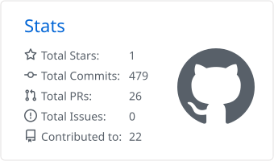
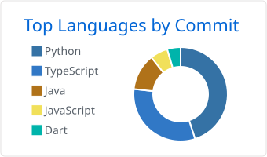

<h1 align="center">Maher Bouchrara</h1>

  <b>Software Engineer · AI &amp; ML · LLMs &amp; Agents</b> 
  Final-year Software Engineering student at ISI Ariana, Tunisia

  
  
  

---

I build software around language models: tools that use them, pipelines that orchestrate them, and the security layers that make them safe to use with real data. I care about the engineering around the model as much as the model itself: clear architecture, tests, and honest documentation.

- **Now:** part-time Software Engineer at **VamiSec**, building VamiGuard, a Chrome extension that detects sensitive data in AI chat prompts and masks it in the browser before it is sent (rule-based detection plus GLiNER named-entity recognition).
- **Summer 2026:** AI &amp; Web Engineer intern at **Binacts**. I built an LLM security gateway with reversible PII anonymisation (Presidio, LLM Guard, LiteLLM, FastAPI) and an audit dashboard in React.
- **Interests:** LLM applications, RAG, AI agents and multi-agent systems, AI security, backend and software architecture.

## Tech stack

<table>
  <tr>
    <td><b>Languages</b></td>
    <td></td>
  </tr>
  <tr>
    <td><b>AI / ML</b></td>
    <td>
       
      
      
      
      
      
      
      
      
    </td>
  </tr>
  <tr>
    <td><b>Backend</b></td>
    <td></td>
  </tr>
  <tr>
    <td><b>Frontend &amp; mobile</b></td>
    <td></td>
  </tr>
  <tr>
    <td><b>Data</b></td>
    <td></td>
  </tr>
  <tr>
    <td><b>DevOps &amp; tools</b></td>
    <td></td>
  </tr>
</table>

## Selected projects

Most recent first.

| Project | What it is | Stack |
|---|---|---|
| [**Editing Master**](https://github.com/Maher-bouchrara/Editing-Master-skill)  Nov 2026 | A Claude Code plugin that guides an AI agent through making short product videos with HyperFrames: script, voice, music, camera zooms, subtitles. | Claude Code skills, HyperFrames, GSAP |
| [**AI Background Replacer**](https://github.com/Maher-bouchrara/bg-changer-MODELIA)  Oct 2026 | Puts a photo's subject on a new background with clean edges and realistic shadows. CLI, REST API and web page, benchmarked across 5 segmentation models on 970 images, with 154 tests. | PyTorch, BiRefNet, FastAPI, Next.js, Docker |
| [**Sakina**](https://github.com/Maher-bouchrara/sakina-quran)  Sep 2026 | A Quran recitation player that shows one verse at a time with word-by-word highlighting and coloured tajwid. [Live](https://the-sakina-quran.vercel.app) | Vanilla JS, Quran.com API |
| **Candidature Studio**  Sep 2026 · private | Job-application studio: versioned CV and letter data, one-page PDF rendering, LLM-assisted tailoring validated against the user's own data, batched SMTP sending. | Next.js, TypeScript, libSQL, Puppeteer, Vitest |
| **LLM Security Gateway**  Jun 2026 · internship · private | A gateway between users and cloud LLMs. It anonymises personal data reversibly, screens prompts for injection and replies for toxicity, and logs everything to an audit dashboard. | FastAPI, Presidio, LLM Guard, LiteLLM, React |
| [**Semantic Paper Search**](https://github.com/Maher-bouchrara/semantic-paper-search)  May 2026 | Ranks scientific publications against a query using embeddings over title, abstract and PDF text. Part of a research-publications platform. | FastAPI, Sentence Transformers, PyMuPDF |
| [**Live Quiz Platform**](https://github.com/Maher-bouchrara/live-quiz-platform)  Mar 2026 · with Maher Ayachi | Real-time quiz system in the style of Mentimeter and Kahoot, with AI quiz generation, a host app and a participant app. | NestJS, GraphQL, Prisma, Flutter, Firebase |

**Team projects I contributed to:**
- [MLOps platform](https://github.com/Blhasn-Sehli/mlops-platform), covering training, deployment and drift monitoring
- [exam supervision scheduler](https://github.com/MaherxBlhasn/Compet_Univ), using constraint programming with OR-Tools
- [Odyssee Travel dashboard](https://github.com/MaherxBlhasn/ODYSSEE-TRAVEL-Services-Dashboard)
- [Job Match](https://github.com/MaherxBlhasn/job-match)

More projects, with demos, are on my [portfolio](https://maher-bouchrara.vercel.app).

## GitHub activity

  <picture>
    <source media="(prefers-color-scheme: dark)" srcset="https://streak-stats.demolab.com?user=Maher-bouchrara&theme=github-dark-blue&hide_border=true">
    
  </picture>

  <picture>
    <source media="(prefers-color-scheme: dark)" srcset="profile-summary-card-output/github_dark/3-stats.svg">
    
  </picture>
  <picture>
    <source media="(prefers-color-scheme: dark)" srcset="profile-summary-card-output/github_dark/2-most-commit-language.svg">
    
  </picture>

---

Open to AI/ML and backend engineering opportunities · <a href="https://maher-bouchrara.vercel.app">maher-bouchrara.vercel.app</a>

