

  <a href="https://maher-bouchrara.vercel.app"></a>

  

  
  
  
  

## About me

I build software around language models: tools that use them, pipelines that orchestrate them, and the security layers that make them safe to use with real data. I care about the engineering around the model as much as the model itself: clear architecture, tests and honest documentation.

- **Now:** part-time Software Engineer at **VamiSec**, building VamiGuard, a Chrome extension that detects sensitive data in AI chat prompts and masks it in the browser before it is sent (rule-based detection plus GLiNER named-entity recognition).
- **Summer 2026:** AI &amp; Web Engineer intern at **Binacts**. I built an LLM security gateway with reversible PII anonymisation (Presidio, LLM Guard, LiteLLM, FastAPI) and an audit dashboard in React.
- **Interests:** LLM applications, RAG, AI agents and multi-agent systems, AI security, backend and software architecture.

## Tech stack

  <b>LANGUAGES</b> 
    
  <b>AI &amp; MACHINE LEARNING</b> 
   
  
  
  
  
  
  
  
    
  <b>BACKEND</b> 
    
  <b>FRONTEND &amp; MOBILE</b> 
    
  <b>DATA</b> 
    
  <b>DEVOPS &amp; TOOLS</b> 
  

## Featured projects

Most recent first.

  <a href="https://github.com/Maher-bouchrara/Editing-Master-skill"></a>
  <a href="https://github.com/Maher-bouchrara/sakina-quran"></a>
  <a href="https://github.com/Maher-bouchrara/semantic-paper-search"></a>
  <a href="https://github.com/Maher-bouchrara/live-quiz-platform"></a>
  <a href="https://github.com/Maher-bouchrara/face-recognition-intruder-detection"></a>
  <a href="https://github.com/Maher-bouchrara/training-center-api"></a>

**Also**

- [**bg-changer-MODELIA**](https://github.com/Maher-bouchrara/bg-changer-MODELIA) · Oct 2026 — background replacement with BiRefNet segmentation, clean edges and shadows: CLI, FastAPI API and Next.js page, benchmarked across 5 models.
- **Candidature Studio** · Sep 2026 · private — job-application studio: versioned CV and letter data, one-page PDF rendering, LLM-assisted tailoring, batched SMTP sending.
- **LLM Security Gateway** · Jun 2026 · internship · private — reversible PII anonymisation, prompt-injection and toxicity screening between users and cloud LLMs, with an audit dashboard.
- **Team projects** — [MLOps platform](https://github.com/Blhasn-Sehli/mlops-platform) · [Exam supervision scheduler](https://github.com/MaherxBlhasn/Compet_Univ) · [Odyssee Travel dashboard](https://github.com/MaherxBlhasn/ODYSSEE-TRAVEL-Services-Dashboard) · [Job Match](https://github.com/MaherxBlhasn/job-match)

## Contributions

  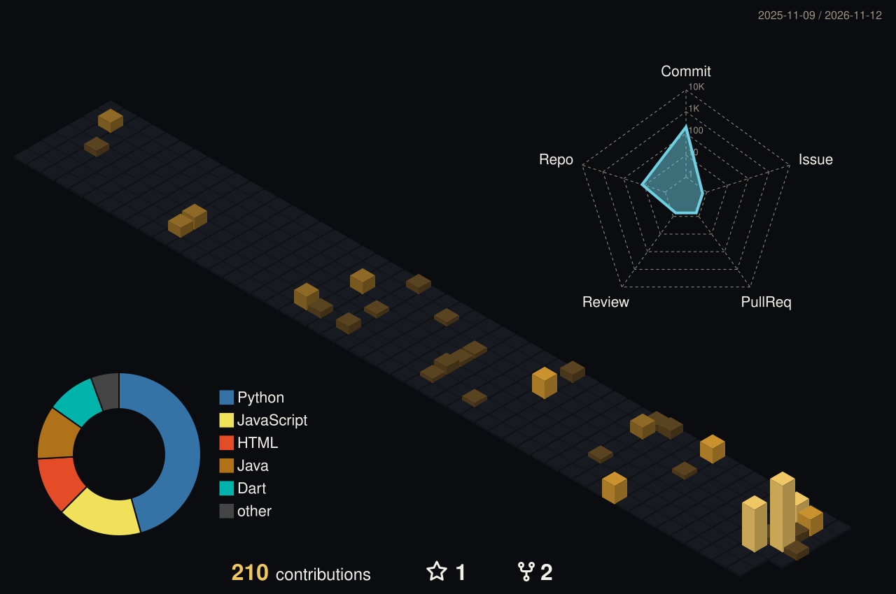

  

  
  

  

  <a href="https://maher-bouchrara.vercel.app"></a>

